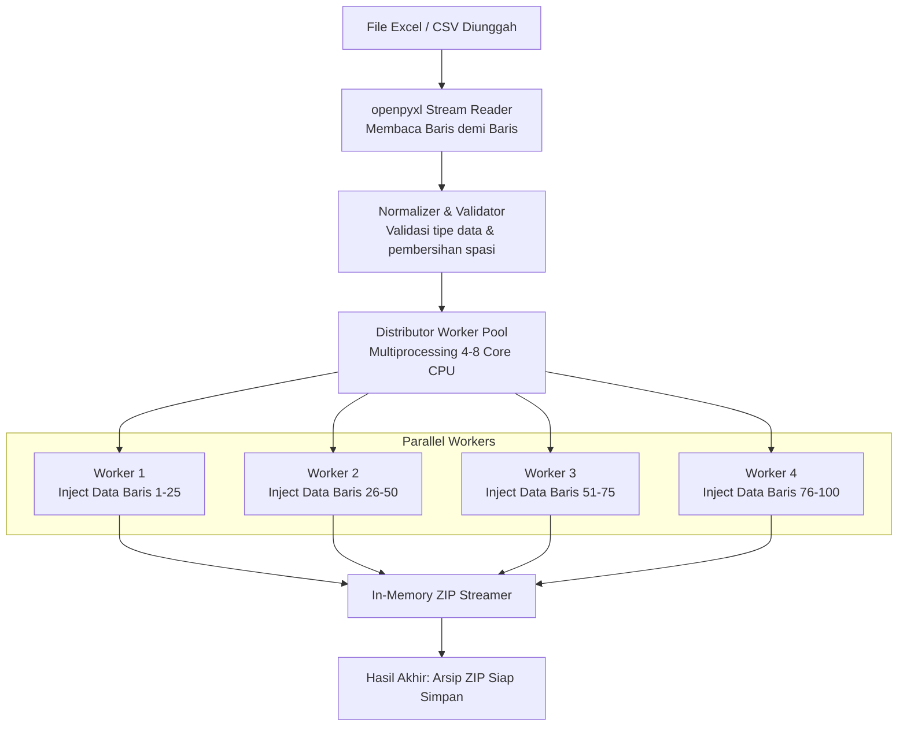

# Arsitektur Sistem & Engine: FastDoc

Dokumen ini menjelaskan rancangan arsitektur teknis, struktur subsistem, dan mekanisme internal mesin pemrosesan dokumen FastDoc dalam bentuk aplikasi desktop Windows mandiri.

---

## 1. Arsitektur Tingkat Tinggi (Desktop High-Level Architecture)

FastDoc dirancang menggunakan pola **Separation of Concerns (SoC)** antara antarmuka pengguna (Desktop UI) dan mesin pemroses dokumen (Core Python Engine) yang berjalan secara lokal di komputer pengguna.

```
┌─────────────────────────────────────────────────────────────────────────────┐
│                          APLIKASI DESKTOP FASTDOC                           │
│                                                                             │
│  ┌───────────────────────────────────────────────────────────────────────┐  │
│  │ 1. Antarmuka Pengguna (Desktop UI / Frontend)                         │  │
│  │    • Teknologi: React 18 / Vite + TypeScript + TailwindCSS            │  │
│  │    • Render Engine: Microsoft Edge WebView2 (Native Windows)          │  │
│  │    • Fungsi: Drag & drop template, preview skema, dynamic form,       │  │
│  │      tabel input batch (spreadsheet), prompt AI, tombol generate.     │  │
│  └───────────────────────────────────┬───────────────────────────────────┘  │
│                                      │                                      │
│                Komunikasi Lokal      │ IPC / Localhost HTTP (REST API)      │
│                (Port Acak Dinamis)   │ Port: 127.0.0.1:49152+ (Loopback)    │
│                                      ▼                                      │
│  ┌───────────────────────────────────────────────────────────────────────┐  │
│  │ 2. Mesin Inti (FastDoc Embedded Python Engine)                        │  │
│  │    • Backend: FastAPI / Uvicorn (Terkonfigurasi Tanpa Akses Jaringan) │  │
│  │    • Parser OpenXML: docxtpl + python-docx + defusedxml               │  │
│  │    • Batch Engine: openpyxl + multiprocessing pool                    │  │
│  │    • AI Orchestrator: OpenAI/Claude API SDK + Local Ollama Connector  │  │
│  │    • PDF Exporter: Headless Word COM Automation / LibreOffice Mini    │  │
│  └───────────────────────────────────┬───────────────────────────────────┘  │
│                                      │                                      │
│                                      ▼                                      │
│  ┌───────────────────────────────────────────────────────────────────────┐  │
│  │ 3. Penyimpanan Lokal (Local Filesystem Sandbox)                       │  │
│  │    • C:\Users\<User>\AppData\Local\FastDoc\templates                  │  │
│  │    • Folder Tujuan Ekspor (Folder Dokumen / Flashdisk Pengguna)       │  │
│  └───────────────────────────────────────────────────────────────────────┘  │
└─────────────────────────────────────────────────────────────────────────────┘
```

---

## 2. Mengapa Arsitektur Ini Dipilih?

1. **Ringan dan Sangat Cepat:**  
   Dengan memanfaatkan WebView2 bawaan Windows 10/11, aplikasi desktop tidak perlu menyertakan browser Chromium yang berat (seperti Electron konvensional). Ukuran installer bisa ditekan hingga ~35–45 MB.
2. **Keamanan Maksimal (Air-Gapped & Offline Ready):**  
   Server lokal hanya mendengar panggilan dari `127.0.0.1` dan tidak dapat diakses dari jaringan luar. Data siswa, NIK, dan nominal kontrak tersimpan aman di RAM komputer pengguna dan langsung dibersihkan setelah selesai dicetak.
3. **Tanpa Ketergantungan Eksternal:**  
   Python runtime dibungkus secara *self-contained* menggunakan PyInstaller/Nuitka. Komputer pengguna tidak perlu menginstall Python, pip, atau compiler C++.

---

## 3. Mekanisme Kerja OpenXML In-Place Injection

Kunci utama agar **layout, kop surat, tabel, dan margin tidak rusak** adalah memahami anatomi internal file Microsoft Word (`.docx`).

### 3.1 Anatomi File `.docx`
File `.docx` sesungguhnya adalah file arsip ZIP dengan struktur folder berikut:
```
[Dokumen.docx]
├── [Content_Types].xml
├── _rels/
├── word/
│   ├── document.xml      <-- Teks utama isi dokumen
│   ├── header1.xml       <-- KOP SURAT, LOGO, & HEADER RESMI
│   ├── footer1.xml       <-- Halaman & catatan kaki
│   ├── styles.xml        <-- Definisi font, spasi, warna, dan ukuran
│   ├── numbering.xml     <-- Format penomoran otomatis
│   └── media/            <-- Gambar logo, foto, stempel (.png / .jpeg)
```

### 3.2 Masalah Pemecahan Run XML (*The Run-Splitting Problem*)
Ketika pengguna mengedit template di Microsoft Word, teks `{{ nama_lengkap }}` sering kali dipecah oleh Word ke dalam beberapa node `<w:r>` (Run):

```xml
<!-- Sebelum Rekonsiliasi (Bawaan Word saat diedit) -->
<w:p>
  <w:r><w:t>Nama: </w:t></w:r>
  <w:r><w:t>{</w:t></w:r>
  <w:r><w:t>{nama_</w:t></w:r>
  <w:r><w:t>lengkap</w:t></w:r>
  <w:r><w:t>}}</w:t></w:r>
</w:p>
```
Jika kita hanya melakukan pencarian string biasa, tag `{{ nama_lengkap }}` tidak akan ditemukan karena terpotong-potong.

### 3.3 Solusi Algoritma Run Reconciliation di FastDoc Engine:
FastDoc menerapkan tahap normalisasi sebelum rendering:
1. Memindai setiap paragraf `<w:p>`.
2. Mendeteksi apakah ada kurung buka `{{` yang belum tertutup dalam satu `<w:r>`.
3. Menggabungkan teks dari run-run terkait ke dalam satu run utama dengan tetap mempertahankan style formatting (`<w:rPr>`).
4. Hasil normalisasi:
```xml
<!-- Setelah Rekonsiliasi Run -->
<w:p>
  <w:r><w:t>Nama: </w:t></w:r>
  <w:r><w:rPr><w:b/></w:rPr><w:t>{{ nama_lengkap }}</w:t></w:r>
</w:p>
```
5. Mesin Jinja2 kemudian mengevaluasi tag dan mengganti nilainya secara in-place.

---

## 4. Pipeline Pemrosesan Dokumen Massal (Batch Processing Pipeline)

Untuk menghasilkan 100 dokumen dalam waktu < 2 detik, sistem menggunakan pipeline paralel asinkron:



* **Teknik Memory-Stream:** Sistem tidak menulis file perantara ke hard disk satu per satu, melainkan menulis langsung ke RAM stream buffer (`io.BytesIO`) lalu di-stream ke file ZIP. Ini mempercepat proses hingga 5x lipat dibanding I/O disk konvensional.

---

## 5. Mesin Konversi PDF Lokal (Headless PDF Service)

Pada sistem operasi Windows, terdapat dua strategi konversi PDF berkualitas tinggi:

1. **Strategi A (Prioritas Utama - Native Word Automation):**  
   Jika di komputer pengguna sudah terpasang Microsoft Word, FastDoc dapat memanggil COM API (`win32com.client`) di latar belakang secara hening (*headless*). Ini menjamin rendering PDF 100% identik dengan hasil cetak asli Microsoft Word.
2. **Strategi B (Fallback - Standalone Engine):**  
   Jika pengguna tidak memiliki Microsoft Word terpasang, sistem menyertakan micro-binary LibreOffice portable atau pustaka rendering OpenXML-to-PDF mandiri.
