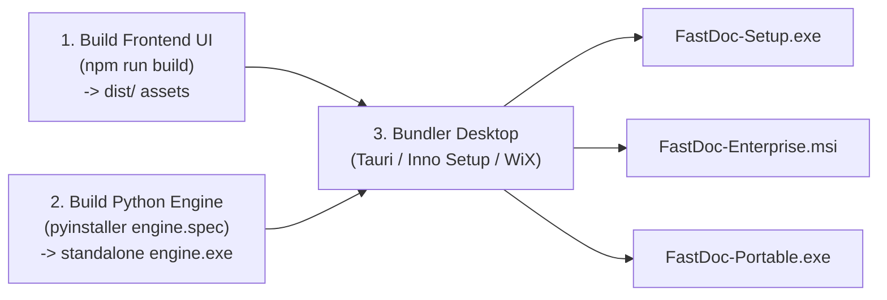

# Panduan Packaging & Distribusi Desktop (.exe & .msi): FastDoc

Dokumen ini menjelaskan prosedur kompilasi, pembungkusan (*bundling*), dan distribusi aplikasi FastDoc ke dalam format file instalasi Windows yang siap digunakan oleh pengguna awam tanpa memerlukan instalasi software pendukung lainnya.

---

## 1. Sasaran Distribusi Windows

Aplikasi FastDoc didistribusikan dalam tiga format paket utama:

```
┌─────────────────────────┬─────────────────────────────────────────────────┐
│ Format Paket            │ Target Pengguna & Karakteristik                 │
├─────────────────────────┼─────────────────────────────────────────────────┤
│ FastDoc-Setup.exe       │ Pengguna Umum (Guru / Staf TU / HRD)            │
│ (NSIS / Inno Setup)     │ • Wizard instalasi standar (Next > Finish)      │
│                         │ • Otomatis pasang icon di Desktop & Start Menu  │
│                         │ • Support instalasi tanpa hak Administrator     │
├─────────────────────────┼─────────────────────────────────────────────────┤
│ FastDoc-Enterprise.msi  │ Administrator IT Sekolah / Instansi Pemerintah  │
│ (Windows Installer)     │ • Mendukung deployment massal via Active Dir    │
│                         │ • Mendukung silent install: msiexec /i /qn      │
├─────────────────────────┼─────────────────────────────────────────────────┤
│ FastDoc-Portable.exe    │ Pengguna Fleksibel / Flashdisk                  │
│ (Self-Contained)        │ • Tanpa proses install, langsung jalan          │
│                         │ • Cocok disimpan di USB Flashdisk               │
└─────────────────────────┴─────────────────────────────────────────────────┘
```

---

## 2. Struktur Bundling Mandiri (Self-Contained Packaging)

Pengguna Windows yang ditargetkan mayoritas tidak memiliki Python atau Node.js di komputernya. Oleh karena itu, seluruh runtime harus dibungkus menjadi satu paket terpadu.

```
FastDoc/ (Direktori Program Files)
├── FastDoc.exe               <-- Launcher Utama Desktop (Tauri / WebView2 App)
├── engine/                   <-- Standalone Python Engine (Tanpa Python Eksternal)
│   ├── fastdoc_engine.exe    <-- Dihasilkan via PyInstaller / Nuitka
│   ├── python312.dll         <-- Embedded DLL runtime
│   └── lib/                  <-- Pustaka OpenXML (docxtpl, openpyxl, dll)
├── ui/                       <-- Berkas frontend statis (HTML/CSS/JS)
│   ├── index.html
│   └── assets/
└── icon.ico                  <-- Logo aplikasi
```

---

## 3. Tahapan Proses Build (Compilation Pipeline)

Proses pembuatan file instalasi terdiri dari 3 langkah berurutan:



### 3.1 Langkah 1: Kompilasi Antarmuka Web (Frontend)
```bash
cd frontend
npm install
npm run build
# Menghasilkan folder dist/ yang berisi HTML, JavaScript, dan CSS yang teroptimasi.
```

### 3.2 Langkah 2: Pembungkusan Python Engine (Backend)
Menggunakan **PyInstaller** dengan spesifikasi mode satu folder (`--onedir`) untuk kecepatan startup maksimal:
```bash
cd backend
pyinstaller --noconfirm --clean \
    --name fastdoc_engine \
    --onedir \
    --noconsole \
    --add-data "templates_base;templates_base" \
    --hidden-import "docxtpl" \
    --hidden-import "openpyxl" \
    --hidden-import "uvicorn" \
    --hidden-import "fastapi" \
    main.py
```

### 3.3 Langkah 3: Pembuatan Installer (.exe & .msi)

#### A. Membuat Installer `.exe` Menggunakan Inno Setup:
Script Inno Setup (`fastdoc_setup.iss`) mengompilasi seluruh file hasil ke dalam satu file installer:
```pascal
[Setup]
AppName=FastDoc
AppVersion=1.0.0
DefaultDirName={autopf}\FastDoc
DefaultGroupName=FastDoc
OutputDir=dist_installer
OutputBaseFilename=FastDoc-Setup-1.0.0
Compression=lzma2/ultra64
SolidCompression=yes
PrivilegesRequired=lowest  ; Mengizinkan install tanpa admin prompt!

[Files]
Source: "release_bundle\*"; DestDir: "{app}"; Flags: ignoreversion recursesubdirs

[Icons]
Name: "{autoprograms}\FastDoc"; Filename: "{app}\FastDoc.exe"
Name: "{autodesktop}\FastDoc"; Filename: "{app}\FastDoc.exe"
```

#### B. Membuat Installer `.msi` Menggunakan WiX Toolset:
Untuk lingkungan kantor pemerintah dan sekolah yang memerlukan distribusi via jaringan lokal (GPO):
```bash
wix build fastdoc.wxs -ext WixToolset.UI.wixext -o FastDoc-1.0.0.msi
```

---

## 4. Penanganan Keamanan & Windows SmartScreen

Ketika aplikasi baru pertama kali diunduh di Windows 10/11, Windows Defender SmartScreen sering menampilkan peringatan biru (*"Windows protected your PC"*).

### Langkah Mitigasi:
1. **Code Signing Certificate (Sertifikat Penandatanganan Digital):**  
   Menandatangani file `.exe` dan `.msi` menggunakan sertifikat digital (Certum / DigiCert / Sectigo) dengan tool `signtool.exe`:
   ```bash
   signtool sign /tr http://timestamp.digicert.com /td sha256 /fd sha256 /a FastDoc-Setup.exe
   ```
2. **Reputasi Biner & Antivirus Whitelist:**  
   Untuk rilis tahap awal internal/sekolah sebelum membeli sertifikat EV berbayar, sediakan panduan sederhana: *"Klik 'More info' -> Klik 'Run anyway' pada saat pertama kali menjalankan installer"*.

---

## 5. Fitur Pembaruan Otomatis (Auto-Updater)

Agar guru dan pengguna tidak perlu mengunduh ulang installer secara manual setiap kali ada perbaikan bug:
* FastDoc dilengkapi modul pengecekan versi ringan saat aplikasi pertama kali dibuka (jika ada koneksi internet).
* Jika versi baru tersedia di GitHub Releases, aplikasi menampilkan tombol: *"Versi baru tersedia, klik untuk update"* dan mengunduh pembaruan secara otomatis di latar belakang.
